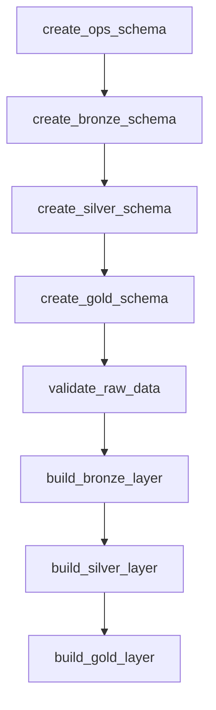

# Omnichannel Retail Pipeline (Databricks)

Pipeline ETL retail omnichannel berbasis Databricks, Spark, dan Delta Lake. Job mengolah data mentah melalui pola medallion **Bronze → Silver → Gold**, dengan task validasi dan pembuatan schema sebagai prasyarat.

## Alur DAG



Seluruh task berjalan berurutan: kegagalan pada satu task akan mencegah task berikutnya berjalan.

| Urutan | Task | Fungsi |
|---|---|---|
| 1–4 | `create_ops_schema`, `create_bronze_schema`, `create_silver_schema`, `create_gold_schema` | Menjalankan SQL untuk menyiapkan objek schema operasional dan medallion. |
| 5 | `validate_raw_data` | Memeriksa manifest, file JSON/CSV, dan kolom wajib. Error yang dianggap berisiko menghentikan pipeline. Laporan ditulis ke `/tmp/validation_report.txt`. |
| 6 | `build_bronze_layer` | Membaca 19 file JSON/CSV dari volume dan menulis Delta table di `workspace.bronze`. Penulisan memakai mode `overwrite`. |
| 7 | `build_silver_layer` | Membentuk dan membersihkan tabel Silver, termasuk normalisasi timestamp/status, deduplikasi, resolusi identitas, pemeriksaan relasi, penanganan data terlambat, dan quality gate. |
| 8 | `build_gold_layer` | Membuat ulang mart Gold, menjalankan rekonsiliasi, dan mencatat metadata run. |

Task Silver menjalankan 11 tahap internal secara berurutan; detail implementasinya ada di `src/build_silver.py` dan `src/silver_files/`.

## Data dan tabel

Data sumber berada di `data/raw/`:

- `operational/`: customers, alamat/profil pelanggan, produk, kategori, toko, channel, promosi, pesanan, item, dan promosi pesanan.
- `events/`: payment, refund, return, support, dan web events.
- `inventory/`: snapshot inventori CSV.
- `reference/`: referensi kota dan belanja kampanye CSV.

Sebelum menjalankan job, file sumber harus tersedia pada volume Databricks yang dibaca oleh `src/build_bronze.py`:

```text
/Volumes/workspace/retail_nama_raw/omnicahnnel_retail_pipeline/data/raw
```

Pemeriksaan di `src/raw_data_validation.py` juga mencari file di `data/raw/` relatif terhadap proses job. Pastikan file yang sama dapat diakses dari konteks task tersebut. Path volume dan folder data harus disesuaikan jika lokasi penyimpanan di workspace berbeda.

Keluaran utama:

- **Bronze:** `workspace.bronze.<nama_file>` — satu tabel per file sumber.
- **Silver:** `workspace.silver.<nama_tabel>` — data terstruktur dan tervalidasi.
- **Gold:** `workspace.gold.order_360`, `customer_daily`, `product_daily`, `channel_campaign_daily`, dan `executive_kpis_daily`.
- **Operasional:** `workspace.ops` — log kualitas, lineage, deduplikasi, dan metadata run.

Gold dibangun sebagai full refresh (`CREATE OR REPLACE TABLE`), bukan incremental merge.

## Konfigurasi job

Definisi job ada di `resources/retail_pipeline.yml`; konfigurasi bundle ada di `databricks.yml`.

- Nama job: **Omnichannel Retail Pipeline (Medallion)**.
- Jadwal: setiap hari pukul **06.00**, zona waktu `Asia/Jakarta`.
- SQL task memakai SQL warehouse yang ditentukan di resource YAML.
- Python task memakai environment serverless dengan client versi `2`.
- Task merujuk file SQL dan Python melalui path Workspace `/Workspace/database/schemas/` dan `/Workspace/src/`. Pastikan file tersedia di path tersebut pada workspace target sebelum menjalankan job.

## Deploy dan menjalankan

Prasyarat: Databricks CLI terpasang, akses ke workspace/SQL warehouse, serta autentikasi CLI sudah dikonfigurasi.

Dari direktori project:

```bash
databricks bundle validate -t dev
databricks bundle deploy -t dev
databricks bundle run omnichannel_retail_pipeline -t dev
```

Periksa status dan log task melalui **Workflows → Jobs** di Databricks. Jadwal harian aktif setelah job ter-deploy; periksa juga konfigurasi job jika ingin menjalankan pipeline secara manual tanpa menunggu jadwal.

## Troubleshooting

- **File sumber tidak ditemukan:** pastikan file tersedia di volume dan juga bisa dibaca oleh task validasi dari `data/raw/`.
- **File SQL/Python tidak ditemukan:** pastikan resource job menunjuk ke file yang tersedia pada path `/Workspace/...` yang dikonfigurasi.
- **Validasi gagal:** lihat output task serta `/tmp/validation_report.txt`; periksa file JSON, header CSV, dan kolom wajib.
- **Tabel tidak bisa ditulis:** pastikan katalog/schema `workspace` tersedia dan identitas job memiliki izin baca/tulis pada volume serta schema terkait.
- **Gold reconciliation gagal:** periksa status task Silver sebelumnya dan konsistensi jumlah order/rumus revenue di tabel Silver.
